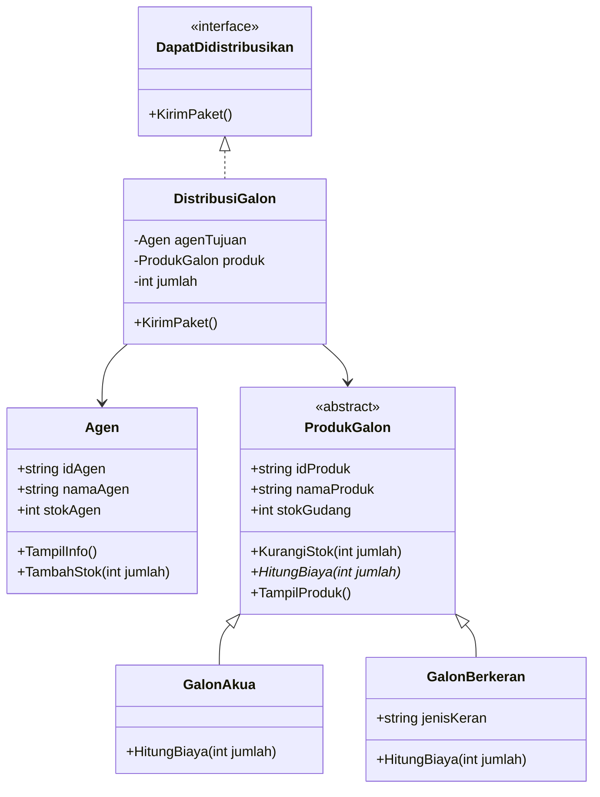

# SISTEM MANAJEMEN DISTRIBUSI GALON
### UTS Pemrograman Berorientasi Objek – Tipe B

## Identitas

| Keterangan | Informasi |
|---|---|
| Kelas | [C] |
| Nama | [Galih Andra Dwinata] |
| 4 Digit NIM | [3079] |
| Tipe Soal | B |
| Mata Kuliah | Pemrograman Berorientasi Objek |
| Bahasa Pemrograman | C# |

---

## 1. Deskripsi Program

Program Sistem Manajemen Distribusi Galon merupakan aplikasi berbasis console yang dibuat menggunakan bahasa pemrograman C# untuk mengelola proses distribusi produk galon kepada agen.

Program ini dibuat berdasarkan studi kasus Mafia Galon, yaitu sebuah sistem yang bertugas mengelola data agen, jenis produk galon, perhitungan biaya, serta proses pengiriman produk dari gudang kepada agen.

Program ini menerapkan konsep Object-Oriented Programming (OOP) atau Pemrograman Berorientasi Objek untuk membangun struktur program yang terorganisasi.

## 2. Tujuan Pembuatan

Tujuan pembuatan program ini adalah:
1. Menerapkan konsep Class dan Object dalam pembuatan sistem.
2. Menerapkan Encapsulation untuk melindungi dan mengontrol akses atribut.
3. Menerapkan Inheritance melalui pewarisan class produk.
4. Menerapkan Polymorphism melalui penggunaan method overriding.
5. Menerapkan Abstract Class sebagai dasar pembentukan class turunan.
6. Menerapkan Interface untuk mendefinisikan kemampuan distribusi produk.
7. Membuat sistem validasi pengiriman agar stok gudang dan agen dapat dikelola dengan benar.

## 3. Struktur Class

Program ini terdiri dari beberapa class dan interface yang memiliki fungsi masing-masing.

### 3.1 Class Agen

Class `Agen` digunakan untuk merepresentasikan agen yang menerima distribusi produk galon.

Atribut yang dimiliki:
- `idAgen`: Menyimpan identitas agen dengan tipe data string.
- `namaAgen`: Menyimpan nama agen dengan tipe data string.
- `stokAgen`: Menyimpan jumlah stok galon yang dimiliki agen dengan tipe data integer.

Method:
- `TampilInfo()`: Menampilkan informasi agen.
- `TambahStok(int jumlah)`: Menambahkan stok agen berdasarkan jumlah galon yang diterima.

### 3.2 Abstract Class ProdukGalon

Class `ProdukGalon` merupakan abstract class yang menjadi class induk bagi seluruh jenis produk galon.

Atribut yang dimiliki:
- `idProduk`: Menyimpan identitas produk.
- `namaProduk`: Menyimpan nama produk.
- `stokGudang`: Menyimpan jumlah stok produk yang tersedia di gudang.

Method:
- `KurangiStok(int jumlah)`: Mengurangi stok gudang dengan melakukan validasi jumlah pengurangan.
- `HitungBiaya(int jumlah)`: Abstract method yang wajib diimplementasikan oleh class turunannya.
- `TampilProduk()`: Menampilkan informasi produk.

### 3.3 Class GalonAkua

Class `GalonAkua` merupakan turunan dari class `ProdukGalon`.

Class ini merepresentasikan produk galon Akua dengan harga Rp20.000 per galon.

Method:
- `HitungBiaya(int jumlah)`: Menghitung total biaya berdasarkan jumlah galon dikalikan harga Rp20.000.

### 3.4 Class GalonBerkeran

Class `GalonBerkeran` merupakan turunan dari class `ProdukGalon`.

Class ini merepresentasikan produk galon berkeran dengan harga Rp12.000 per galon.

Class ini memiliki tambahan atribut:
- `jenisKeran`: Menyimpan informasi jenis keran yang digunakan.

Method:
- `HitungBiaya(int jumlah)`: Menghitung total biaya berdasarkan jumlah galon dikalikan harga Rp12.000.

### 3.5 Interface DapatDidistribusikan

Interface `DapatDidistribusikan` digunakan untuk mendefinisikan kemampuan distribusi atau pengiriman produk.

Interface ini memiliki method:
- `KirimPaket()`: Digunakan untuk menjalankan proses pengiriman paket kepada agen.

### 3.6 Class DistribusiGalon

Class `DistribusiGalon` mengimplementasikan interface `DapatDidistribusikan`.

Class ini bertanggung jawab mengelola proses pengiriman produk galon kepada agen.

Atribut yang dimiliki:
- `agenTujuan`: Menyimpan objek agen penerima.
- `produk`: Menyimpan objek produk galon yang dikirim.
- `jumlah`: Menyimpan jumlah galon yang akan dikirim.

Method:
- `KirimPaket()`: Melakukan validasi pengiriman, mengurangi stok gudang, menambahkan stok agen, serta menampilkan informasi hasil pengiriman.

## 4. Penerapan Konsep PBO

### 4.1 Class dan Object

Class digunakan sebagai cetak biru untuk membuat objek. Contohnya adalah class `Agen`, `GalonAkua`, dan `GalonBerkeran`.

Objek dibuat di dalam method `Main()` menggunakan constructor dari masing-masing class.

Contoh:

```csharp
Agen agen1 = new Agen("A001", "Budi", 10);
Agen agen2 = new Agen("A002", "Andi", 5);
```

### 4.2 Encapsulation

Encapsulation diterapkan dengan membatasi akses terhadap atribut melalui properties.

Contoh:

```csharp
public int stokGudang { get; private set; }
```

Penggunaan `private set` membuat nilai stok tidak dapat diubah secara langsung dari luar class. Pengurangan stok dilakukan melalui method `KurangiStok()` agar perubahan nilai dapat dikontrol.

### 4.3 Inheritance

Inheritance diterapkan melalui pewarisan class `ProdukGalon` kepada dua class turunan, yaitu `GalonAkua` dan `GalonBerkeran`.

Contoh:

```csharp
public class GalonAkua : ProdukGalon
```

```csharp
public class GalonBerkeran : ProdukGalon
```

Dengan inheritance, kedua class turunan dapat menggunakan atribut dan method yang dimiliki class induknya.

### 4.4 Polymorphism

Polymorphism diterapkan melalui method overriding pada method `HitungBiaya()`.

Masing-masing class turunan memiliki implementasi perhitungan biaya yang berbeda sesuai harga produknya.

Contoh:

```csharp
ProdukGalon produk1 = akua;
ProdukGalon produk2 = keran;

produk1.HitungBiaya(3);
produk2.HitungBiaya(5);
```

Walaupun menggunakan tipe referensi `ProdukGalon`, method yang dijalankan menyesuaikan jenis objek sebenarnya.

### 4.5 Abstract Class

Abstract class diterapkan pada class `ProdukGalon`.

Class ini tidak dapat dibuat menjadi objek secara langsung dan memiliki abstract method `HitungBiaya()` yang wajib diimplementasikan oleh class turunannya.

Contoh:

```csharp
public abstract class ProdukGalon
{
    public abstract void HitungBiaya(int jumlah);
}
```

### 4.6 Interface

Interface diterapkan melalui `DapatDidistribusikan` yang diimplementasikan oleh class `DistribusiGalon`.

Contoh:

```csharp
public interface DapatDidistribusikan
{
    void KirimPaket();
}
```

```csharp
public class DistribusiGalon : DapatDidistribusikan
```

Dengan demikian, class `DistribusiGalon` wajib menyediakan implementasi method `KirimPaket()`.

## 5. Class Diagram

Class diagram berikut menggambarkan struktur class, atribut, method, serta hubungan antarclass dalam program.



## 6. Pengujian Program

Pengujian dilakukan untuk memastikan seluruh fungsi program berjalan sesuai ketentuan soal.

### 6.1 Pengujian Data Agen

Program membuat dua objek agen dengan data yang berbeda, yaitu:
- Agen A001 dengan nama Budi dan stok awal 10 galon.
- Agen A002 dengan nama Andi dan stok awal 5 galon.

### 6.2 Pengujian Perhitungan Biaya

Pengujian perhitungan biaya dilakukan pada kedua jenis produk.

| Produk | Jumlah | Harga Satuan | Total |
|---|---:|---:|---:|
| Galon Akua | 3 | Rp20.000 | Rp60.000 |
| Galon Berkeran | 5 | Rp12.000 | Rp60.000 |

### 6.3 Pengujian Distribusi Berhasil

Pengiriman sebanyak 20 galon Akua kepada agen Budi berhasil dilakukan karena stok gudang mencukupi.

Perubahan stok:
- Stok gudang: 100 menjadi 80 galon.
- Stok agen Budi: 10 menjadi 30 galon.

### 6.4 Pengujian Distribusi Gagal

Pengiriman sebanyak 100 galon Berkeran kepada agen Andi gagal dilakukan karena stok gudang hanya tersedia 50 galon.

Sistem menampilkan pesan kegagalan dan tidak mengubah stok gudang maupun stok agen.

## 7. Kesimpulan

Berdasarkan hasil pembuatan dan pengujian program, dapat disimpulkan bahwa sistem manajemen distribusi galon berhasil menerapkan enam konsep utama Pemrograman Berorientasi Objek, yaitu Class dan Object, Encapsulation, Inheritance, Polymorphism, Abstract Class, dan Interface.

Program juga mampu melakukan pengelolaan data agen, perhitungan biaya produk, serta validasi proses distribusi berdasarkan ketersediaan stok gudang.

Dengan penerapan konsep PBO, program menjadi lebih terstruktur dan setiap class memiliki tanggung jawab masing-masing.

---
